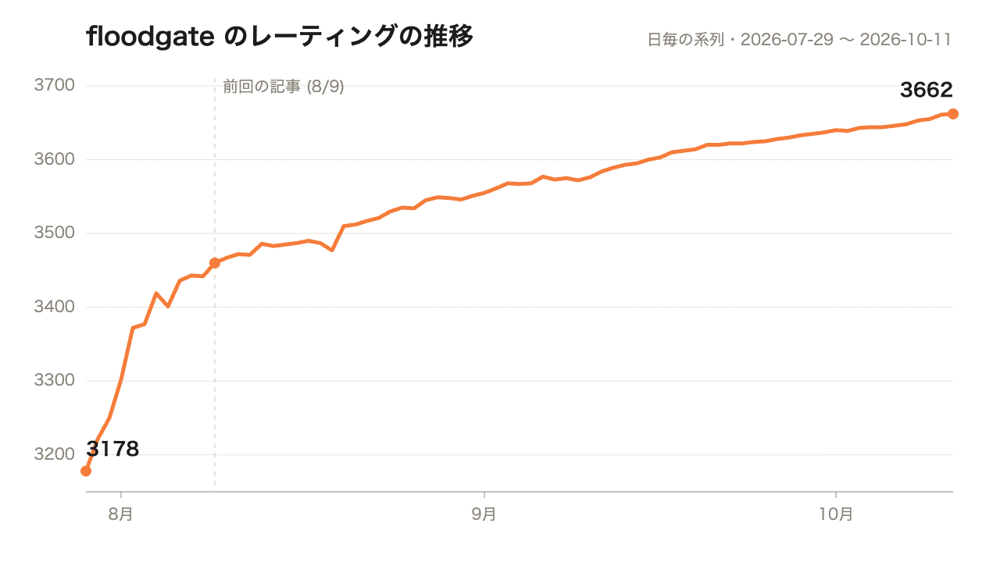

本日はコンピュータ将棋の開発状況のご報告です。前回の記事から2か月が経ちました。

https://note.com/kyamamoto9120/n/nfe667accffd0

この2か月で、floodgate のレーティングは3452から3662まで上がりました。

開発の量でいうと、ADR は78本、PR は400本増えています。

## 強くなった改善は16件

棋力の向上につながった改善は16件でした。探索が7件、評価関数が9件です。日付は取り込んだ日、数字は自己対局で測った伸びです。負けないことだけを確かめて取り込んだ変更（3件）は除いています。

**探索の7件**

- 8/9 指し手を変えずに速くする改善をまとめて入れる: +100.1
- 8/17 桂の3段目の不成を指し手に加える: +11.2
- 8/22 探索の定数24項目を自動調整して焼き込む: +32.0
- 9/2 千日手の判定を16手で打ち切る: +14.3
- 9/6 並列探索で、スレッドごとに読む深さをずらす: +19.8
- 9/8 読み筋が1手で終わったとき、相手の番に考える手を補う: +34.9
- 9/15 探索の定数の自動調整をやり直す: +21.2

**評価関数の9件**

- 8/16 ネットの後段を小さくする: +13.4
- 8/17 駒どうしの組み合わせをネットに入れる: +65.4
- 8/26 兄弟局面の順位を学ぶ損失に変える: +28.9
- 8/29 自分で指して作った局面で学習する: +13.9
- 9/2 教師データを tanuki- の78.6億局面へ移す: +43.2
- 9/10 自分で作った4,700万局面で継続学習する: +20.2
- 10/4 教師データの評価値を dlshogi で付け直す: +74.8
- 10/5 付け直した教師で2周学習する: +25.7
- 10/7 重複を除いて2周学習する: +22.8

並べてみると、探索の改善は9月15日で止まっています。  
それ以降の3件はすべて評価関数です。

探索は、手本にしている OSS のやねうら王に追いつく作業がひと通り終わりました。そこで9月17日から、評価関数の学習と構造に絞っています。

いちばん効果があったのは教師データの評価値の付け直しでした。  
学習に使う局面の評価値を、公開されている深層学習のエンジン dlshogi に付け直してもらいます。

付け直せたのは78.6億局面のうち、まだ先頭の20億局面だけです。それでも、そのデータで学習した評価関数は今までのものに対して+74.8でした。

## 自己対局の合計と実戦の伸びは別物

16件の伸びを単純に足すと+542 Elo です。一方、floodgate のレーティングの伸びは+210でした。

自己対局の Elo は、それぞれ一つ前の版を相手に測った差です。測る相手も条件も毎回違うので、足しても実戦の伸びにはなりません。

前回の最後に書いた「本番の対局を観測する」仕組みは入れました。floodgate の棋譜を定期的に集めて、実戦で評価値が急に崩れた局面を、評価の盲点として測っています。

## 次にやること

教師データの残りの58.5億局面も、dlshogi で付け直します。手元のマシンだと28日ほどかかるので、AWS で回すつもりです。

目標は2027年5月の世界コンピュータ将棋選手権です。また進んだら書きます。
