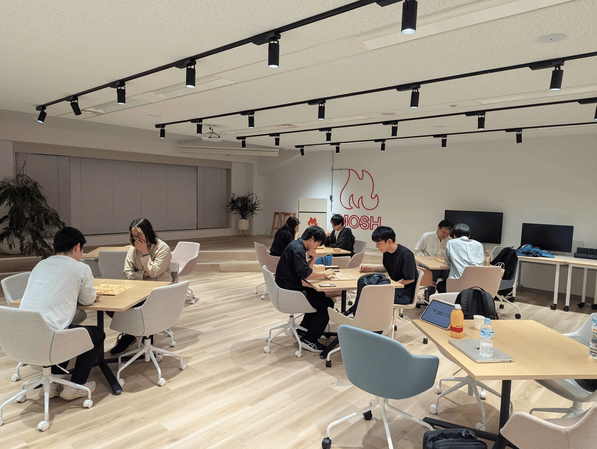

10月は前職仲間の結婚式に行ったり、仕事がバタバタしていたりと、忙しい1ヶ月でした。そのなかで、KomeKaigi のスライドには久々に気合を入れました。

## 10/2 (金) 【EM Oasis #13】ボトルネックは移り変わる

EM Oasis を主催しました。テーマは「実行力ではなく、判断力」です。AI 時代の新しいボトルネックとどう向き合うかを考える回でした。

https://emoasis.connpass.com/event/406128/

ROSCA さんの会場がとてもよく、セッションも OST も盛り上がりました。「AI時代の」で議論される場面が多かったのが印象的でした。

## 10/9 (金) Dev将 #3

エンジニアが集まって将棋を指すイベントの第3回です。

今回は懇親会も MOSH オフィスでケータリングして実施しました。飲みながら詰将棋をしたり、リレー将棋をしたりしたのが新しかったです。楽しかった！

KomeKaigi でも将棋の話をたくさんしたのですが、将棋好きなエンジニアは意外と多いと感じたのでもっと人を集めたいです！

## 10/15 (木) LINE API Expert 制度の終了が発表されました

日本の LINE API Expert 制度と LINE API Platform Evangelist 制度が、2026年末で終わります。

https://developers.line.biz/ja/news/2026/10/15/line-api-expert-program-in-japan-will-be-discontinued/

https://x.com/kyamamoto9120/status/2110745371622400084

感謝の気持ちは別の note に書きました。

https://note.com/kyamamoto9120/n/n4bbb17a0a6ed

## 10/31 (土) KomeKaigi 2026 で登壇しました

「AIに任せられるのは、磨いてきたものだけ」という20分のトークをしました。

https://komekaigi.dev/

https://slides.y-kaz.com/2026-10-31-komekaigi

スライドには結構時間をかけました。AI の聴衆役に4回読んでもらい、指摘を受けて直しました。

話したいことが多すぎて時間には収まりませんでしたが、懇親会も含めてたくさん質問していただけたので良かったです。  
KomeKaigi の参加レポートは後ほど書きます。

---

11月はまた活動が多くなる予定ですし、12月にはアドベントカレンダーが始まります。  
年末忙しい時期に体調を崩すわけにはいかないので、ペース配分を考えながら頑張ります。
