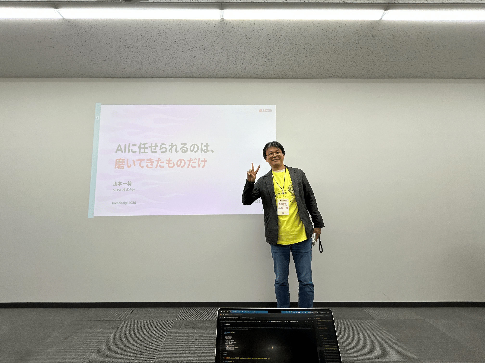
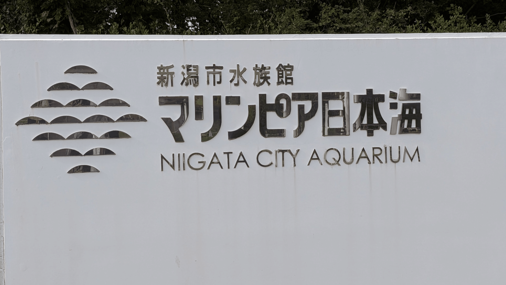
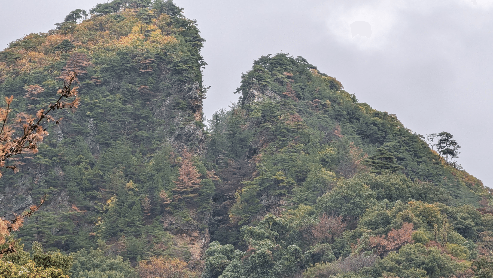
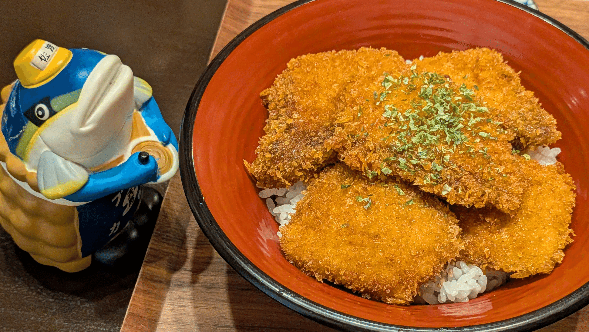

発表は1分オーバーしました。

新潟で開かれた KomeKaigi 2026 で、レギュラートークとして登壇してきました。時間オーバーにもかかわらず、温かくフォローしていただけたカンファレンスでした。

https://komekaigi.dev/

## 会場を見て、緊張した

メインホールに入って、会場が思ったよりずっときれいなことに驚きました。狭いビルの一室を勝手に想像していたのですが、ちゃんとしたイベント会場でした。

久々のカンファレンス登壇ですが、経験もあるし緊張はしないと思っていました。でも会場をみて、運営の方々が力を入れて準備してきた場だと感じて、ここで話すのだと思うと緊張してきました。

## 時間配分は大失敗、それでも救われた

話したのは、7年ぶりに再開した将棋 AI の開発を AI に任せきってみた話です。

https://slides.y-kaz.com/2026-10-31-komekaigi/

伝えたいことが多すぎて、何を話す・何を話さないかの取捨選択に多くの時間をかけました。

それでも本番では前半の説明から時間を使いすぎてしまい、このままでは足りないと気づき、細かな話を飛ばしながら進めました。

ビットボードと配列方式の比較といった実装の詳細は、ほとんどスキップしました。話の道筋に必要なところだけは落とさないように、その場で選びながらつないでいきました。

最後まで話しきったものの、結果は1分オーバーです。運営の皆さまにはご迷惑をおかけしました。私の中では大失敗でした。

それでも、発表後の Ask the Speaker や懇親会には、たくさんの方が話を聞きに来てくださいました。

「自分も将棋が好きなんです」と声をかけてくれた方が多く、10年前といまの将棋界の変化や、AI を使いこなす若手とベテラン棋士の話で盛り上がりました。

*登壇前の様子。緊張でいっぱいです＞＜*

自律的に開発を回すハーネスの仕組みや、AI だけでうまくいった部分について、深く質問してくださる方もいました。

「飛ばしていたけど、違和感なく最後まで聞けた」と言ってくれた方もいました。お世辞もあるだろうと思います。それでも、飛ばす場所をその場で選べたのは準備のおかげだったと、少し前向きに受け止めています。

時間をオーバーしたにもかかわらず温かい反応をたくさんいただき、本当に救われた気持ちになりました。いつか焼き直して、またこの話をしたいです。

## 終わってからは、お祭りだった

発表を終えて肩の荷が下りてからは、まるでお祭りでした。セッションを詰め込むより、ハンズオンに参加したり、人と話したりして過ごしました。

久しぶりにお会いして近況を語り合えた方も、初めましての方もたくさんいて、この場所だからこその出会いを楽しめました。

## 心に残った2本

1本目は、ベネフィット・ワンの小林 逸斗さんによるスポンサーセッションです。新潟拠点で1人から内製チームを立ち上げ、テスト自動生成やコードレビューに生成 AI を組み込んでやりきった事例でした。話の流れもきれいで、とても印象に残りました。

https://fortee.jp/komekaigi-2026/proposal/4f90a8a5-407c-4f30-b847-934dd565e654

2本目は、fubuky35 さんの LT です。世界えだまめ早食い選手権を攻略するために、Meta Quest 3 とエッジ AI で枝豆を検出する MR アプリを作った話でした。登壇は初めてとのことでしたが、LT に慣れきった人のような面白さでした。

https://fortee.jp/komekaigi-2026/proposal/3f87bcb8-2c2d-451d-9178-7e7f8a6883b8

MOSH からも、新潟出身の同僚が LT に出ていました。こちらもとても良い LT でした。

https://fortee.jp/komekaigi-2026/proposal/1f2037b8-cf02-42ad-99ab-8d0c7e3096d1

## 翌日からは、新潟を旅した

カンファレンスの翌日からは、妻と2泊3日で新潟を旅しました。1日目は新潟市内を観光し、水族館の「マリンピア日本海」へ行きました。

ここで見たイルカショーが印象的でした。大きなジャンプのような派手な見せ場だけでなく、オスとメスの見分け方や水中で出す声など、イルカの生態に興味を持たせる工夫があって面白かったです。

翌朝は8時ごろのジェットフォイルで佐渡へ渡りました。あいにくの強い雨でしたが、佐渡金山で見た「道遊の割戸」は衝撃でした。露天掘りで、山が割れるほど掘り進めた跡です。

マインクラフトでもここまでは掘らないだろうと思いました。力強さを感じました。ライトアップされた坑道も心に残っています。

佐渡で1泊して、ブリカツ丼や海鮮など、おいしいものをたくさん食べました。ずっと雨が続いていましたが、最終日はすっきり晴れて、気持ちよくフェリーで帰ってくることができました。

せっかく地方カンファレンスに行くなら、その土地まで楽しまないともったいないと思います。地方カンファレンスは、ご当地まで味わって完成するものだと感じています。少しは新潟に貢献できていたら嬉しいです。

素敵なカンファレンスを準備・運営してくださったスタッフの皆さま、本当にありがとうございました。
