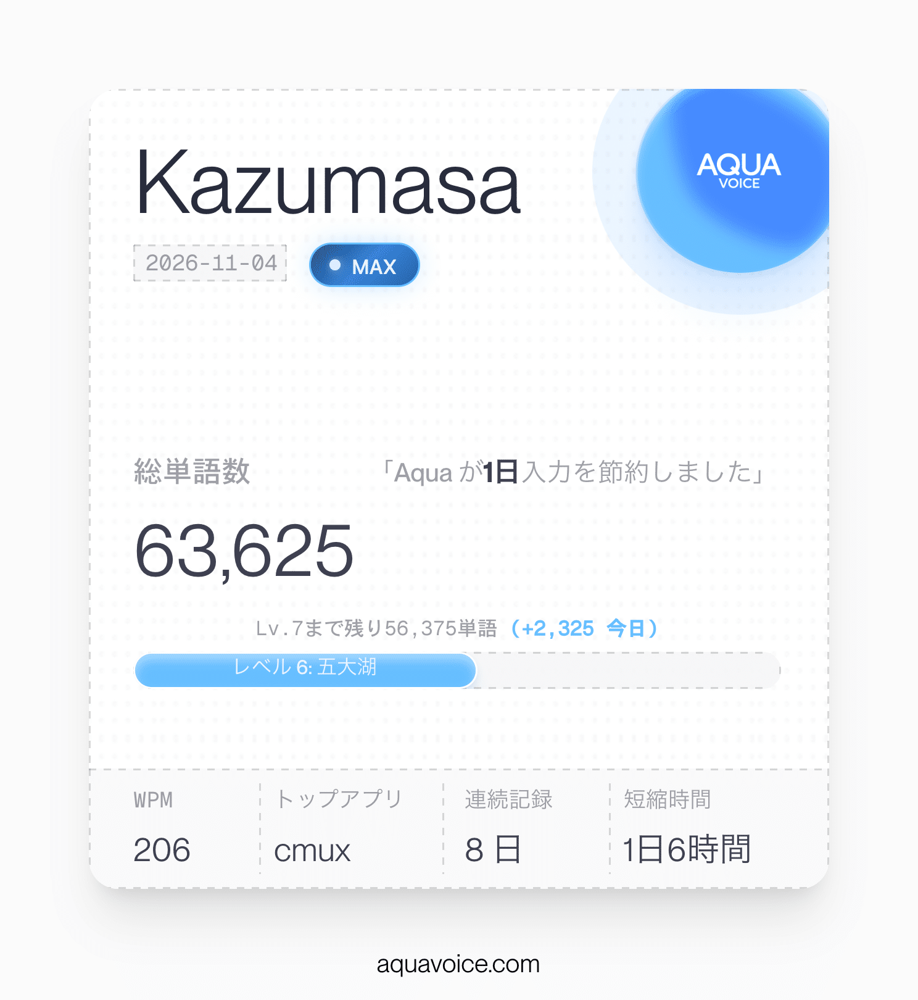
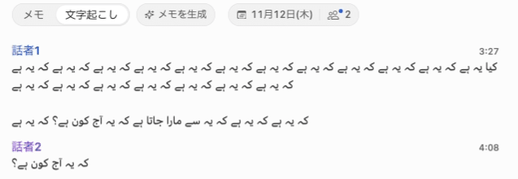
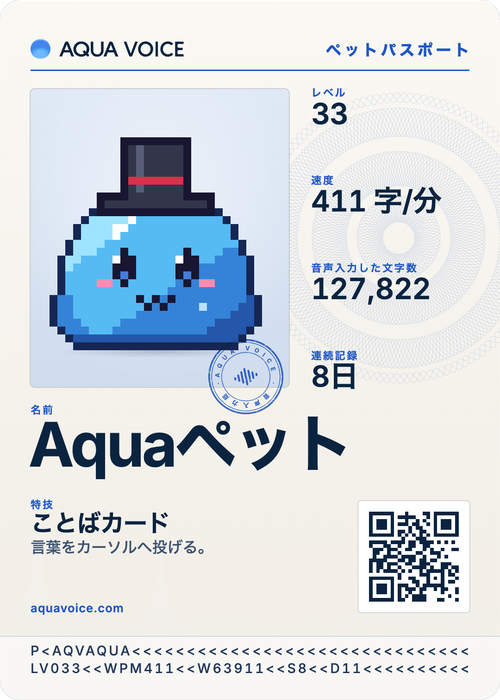

6月末に音声入力をやめたのですが、11月から Aqua Voice の課金を再開しました。

## 6月の仕事のやり方には合わなかった

1月の記事で、音声入力の良さは速さだけではないと書きました。考えをまとめる前に、思っていることを全部喋れることです。この時点では音声入力に大きなメリットを感じていました。

https://note.com/kyamamoto9120/n/n8fa537d1c18b

ところが6月になると、開発のやり方が変わっていました。喋って出すより、頭でまとめてキーボードで打つほうが仕事の質が上がる。そう感じる場面が増えて、使う回数も減りました。

それで一度、課金をやめました。

## キーボードが追いつかなくなった

この4ヶ月で、開発のやり方はまた変わりました。1日にこなせる仕事の量も、6月よりずっと増えています。密度が上がったぶん、今度はキーボード入力がボトルネックになりました。

同じ道具でも、仕事のやり方によって合う時期と合わない時期があるのだと思います。

Aqua Voice の精度が上がったという評判も背中を押しました。

## 前って、こんなに変換うまかったっけ

戻してまず思ったのは、前ってこんなに変換うまかったっけ、ということでした。

日本語の変換で引っかかることが減ったと感じています。声で頼んだことを Claude Code が取り違えて、見当違いの作業を始めることもなくなりました。

Claude Code の側も、話し言葉の指示から意図を汲んで動いてくれます。最近のモデルの力が、ここにも出ているのだと思います。

精度がどれだけ上がったのかは、数字では示せません。6月に何に困っていたのか、具体的な場面も覚えていません。精度はそれほど変わっておらず、変わったのは私の仕事のやり方のほうかもしれません。

それでも、使い心地ははっきり違います。6月に何が引っかかっていたのか、分からなくなるくらいにはうまくいっています。

*11月4日から使い始めた記録*

11月4日から、音声入力した単語は6万語を超えました。Aqua の見積もりでは、入力の時間を1日分縮めたそうです。  
（短縮時間の「1日6時間」って30時間縮めたって意味ですよね？）

## タイミングよく新機能もリリースされた

11月11日には、Aqua Notetaker という議事録の機能が出ました。

https://x.com/aquavoice/status/2120334375946707434

通話が始まると録音も自動で始まるので、取り忘れがありません。Notion の AI ミーティングノートでは、ボタンを押し忘れて「やっちゃった」となることがありました。

リモートの日は、誰が喋っているかの聞き分けも正確でした。ただ、家とマイクが違う出社の日は、こうなりました。

*私は一体何を喋ったんだ*

実用性は、1ヶ月使い倒してから判断します。

## 喋るほど育つペットがいた

いつの間にか、Aqua Voice にペットが登場していました。喋るほどレベルが上がって、いまは Lv.33 です。

名前はまだ付けていません。付けて愛着を育てながら、しばらく使い続けてみます。
